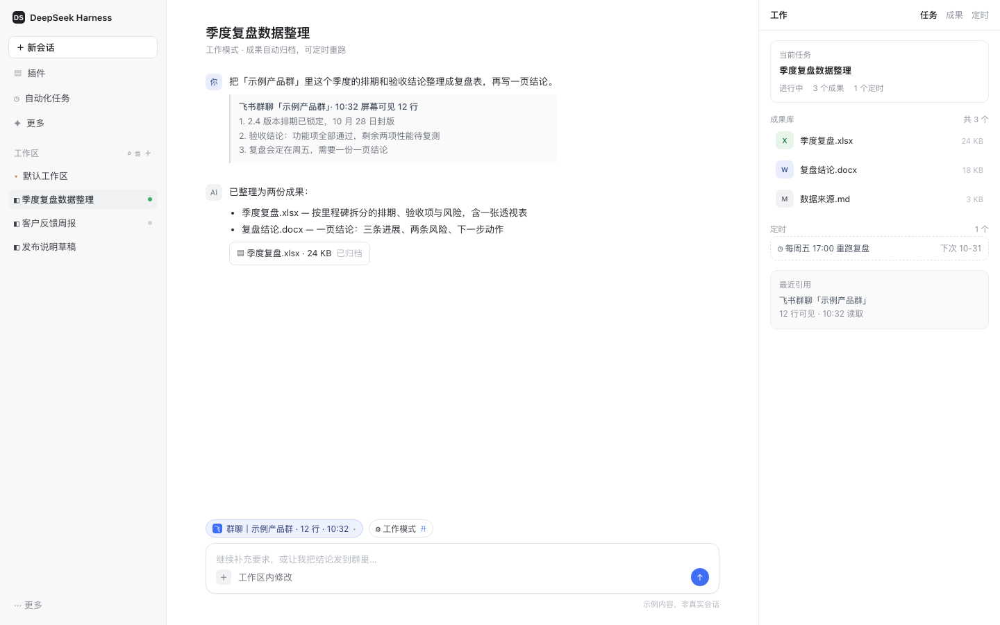
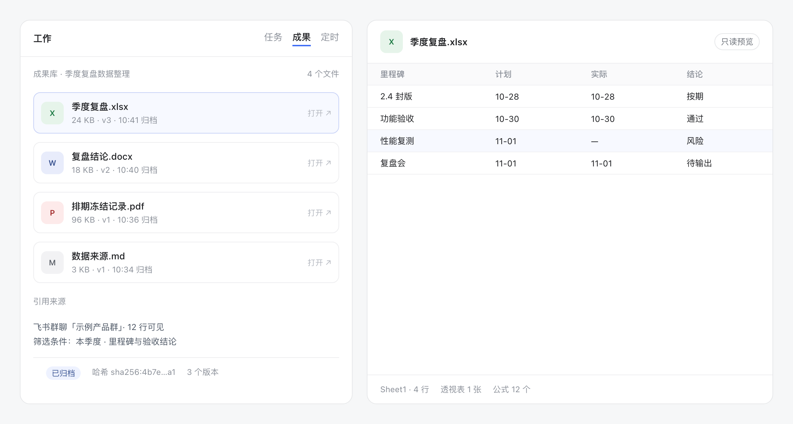
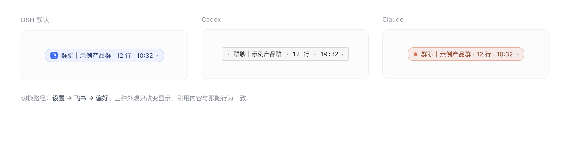

<div align="center">


# DSH Work

**Turn a stated goal into a tracked work task inside DeepSeek Harness — plan, execute, collect deliverables, schedule reruns, and share results to Feishu.**

[English](README.md) · [中文](README.zh.md)

[](https://www.npmjs.com/package/@dsh-work-plug/bundle)
[](https://github.com/silverze/dsh-work-plug/actions/workflows/ci.yml)
[](LICENSE)
[](https://nodejs.org)
[](https://github.com/deepseek-ai)



</div>

DSH Work adds a work layer to [DeepSeek Harness](https://github.com/deepseek-ai): a session can be attached to a **work task** that survives the conversation, collects its own deliverables, can rerun on a schedule, and — on macOS — can quote the Feishu conversation you are looking at straight into the composer.

It is a plugin bundle, not a fork: when you turn it off, DeepSeek Harness is exactly what it was.

## Why DSH Work

- **Work mode, not another preset.** Turn it on for one session; the default preset, other plugins and your settings stay untouched.
- **Deliverables outlive the chat.** Every output is copied into the task's artifact library — docx, pptx, xlsx, images — openable from the panel months later.
- **Recurring work runs itself.** Attach a schedule (daily report, weekly summary) to a task and let the host trigger it.
- **Feishu is a first-class surface.** 14 model-facing Feishu tools for docs, sheets, wiki, IM and drive, and on macOS a composer chip that quotes the conversation currently on your screen.

## Install

### DeepSeek Harness Desktop (recommended)

Open **Settings → Plugins**, search for **DSH Work**, click **Install**, then restart the app.

### CLI / headless

```bash
dsh plugin add @dsh-work-plug/bundle
# restart DeepSeek Harness afterwards
```

### From source

```bash
git clone https://github.com/silverze/dsh-work-plug.git
cd dsh-work
pnpm install
pnpm build
dsh plugin add ./packages/bundle
```

### Requirements

| Requirement | Notes |
| --- | --- |
| DeepSeek Harness `>= 0.2.2-rc.2` | `engines.dsh` of the bundle enforces this |
| Node.js `>= 24` | only needed to build from source |
| macOS 13+ | required for the Feishu conversation chip and screen text tools |
| Xcode Command Line Tools | the screen helper is compiled with `swiftc` on first use (~25 s, then cached) |
| Screen Recording permission | macOS asks once when the chip first reads Feishu |
| Feishu app credentials | only for the Feishu tools; see [docs/feishu-app-setup.md](docs/feishu-app-setup.md) |

## Quick start

1. Open a session and click **工作模式 / Work mode** above the composer.
2. Describe the outcome you want — *"prepare the Q4 review deck from these three docs"*.
3. The right panel becomes a workbench: the current task, its plan and its artifact library.
4. Ask for changes in the same conversation; every output lands in the artifact library.
5. Optional: schedule the task, or share an artifact to a Feishu doc with one sentence.



## Feishu conversation context (macOS)

When work mode is on, a chip appears above the composer with the Feishu chat you were last looking at:



- **Click the chip** to insert a quoted block with the chat name, the read time and the visible messages.
- **Click ▾** to pick one of the recent conversations or force a fresh read.
- The chip **follows** the focused conversation while Feishu is in front (about 1.2 s per read, at most every 2.5 s).
- If the read fails — Feishu minimized, on another Space, or permission revoked — the chip keeps the last conversation, marks it **上次 / last seen**, and still inserts a usable quote.

OCR runs locally. The recognized text goes to the current session only; this plugin uploads nothing. Three appearances (DSH default, Codex, Claude) are selectable in **Settings → Feishu → Preferences**.

## What you get

### Tools

| Group | Tools |
| --- | --- |
| Work tasks | `work_task_create`, `work_task_list`, `work_task_get`, `work_task_prompt`, `work_task_cancel`, `work_task_schedule` |
| Artifacts | `work_artifact_list`, `work_artifact_get`, `work_artifact_scan` |
| Screen awareness | `work_frontmost_app`, `work_screen_text`, `work_feishu_screen`, `work_feishu_focus` |
| Diagnostics | `work_ping` |
| Feishu | `feishu_auth_start`, `feishu_auth_status`, `feishu_auth_disconnect`, `feishu_whoami`, `feishu_doc_create`, `feishu_doc_read`, `feishu_doc_append`, `feishu_wiki_get`, `feishu_sheet_read`, `feishu_sheet_write`, `feishu_sheet_append`, `feishu_im_send`, `feishu_drive_upload`, `feishu_share_artifact` |

### Skills

`work-research` · `work-weekly-report` · `work-meeting-minutes` · `work-data-analysis` · `work-deck` · `work-doc-polish` · `work-screen-awareness`

### UI

- Work-mode chip in the composer, task status badge in the session list, task menu (export / remove).
- Right-side workbench tab: current task, artifacts, schedules.
- Settings section **Feishu**: credentials, connection state, and the chip appearance preference.

## Settings

| Key | Default | Effect |
| --- | --- | --- |
| `accessTokenEnv` | `DSH_FEISHU_USER_ACCESS_TOKEN` | Environment variable read for a Feishu user token |
| `presence` | `true` | Enables the screen/Feishu awareness tools and chip capture on the host |
| `presenceStyle` | `dsh` | Chip appearance: `dsh`, `codex` or `claude` |

Task data lives in the DSH storage domain `work`, so turning the bundle off keeps your tasks, artifacts and schedules.

## How it works

```text
packages/bundle        patch + preset + locale: wires the plugin set into a profile
packages/host-work     tasks, artifacts, schedules, presence tools, screen helper
packages/host-feishu   OAuth, OpenAPI client, Feishu tools
packages/client-work   workbench panel, composer chip, settings (web client plugins)
packages/skills-work   seven bundled skills
```

The host reads the focused Feishu window with a small Swift helper (`CGWindowList` + `screencapture -l` + Vision OCR); the web client only renders snapshots returned by the host. Details: [docs/architecture.md](docs/architecture.md).

## Privacy

- No telemetry, no analytics, no network calls except the Feishu OpenAPI you configure.
- OCR text stays on your machine and in the current session.
- Feishu tokens are stored in the DSH credential store, never in this repository.
- See [SECURITY.md](SECURITY.md) for the full data-flow description.

## Compatibility

| Platform | Work tasks / artifacts / schedules | Feishu tools | Feishu chip / screen text |
| --- | --- | --- | --- |
| macOS 13+ | yes | yes | yes (Screen Recording + Xcode CLT) |
| Linux | yes | yes | no — the tools return an actionable message |
| Windows | yes | yes | no |

Troubleshooting:

| Symptom | Fix |
| --- | --- |
| Chip says `飞书未检测到` | Bring Feishu to the front on the same desktop/Space; the window must be on screen |
| Chip says permission missing | System Settings → Privacy & Security → Screen Recording → enable DeepSeek Harness |
| First read takes ~25 s | `swiftc` is compiling the helper; later reads are ~1.2 s |
| `ERESOLVE` on install | Use DSH `>= 0.2.2-rc.2 < 0.3.0`; peer ranges include the pre-release line |
| Feishu tools say not connected | Run `feishu_auth_start` and finish the browser flow |

## Development

```bash
pnpm install
pnpm build
pnpm test            # builds host/client/feishu, then node --test tests/unit/*.test.mjs
pnpm -r typecheck
pnpm check:public    # internal-identifier and secret guard
pnpm docs:check      # relative links and images
```

See [CONTRIBUTING.md](CONTRIBUTING.md) for the package layout, how to add a tool or skill, and the fixture rules.

## Contributing

Issues and pull requests are welcome. Please read [CONTRIBUTING.md](CONTRIBUTING.md) and [CODE_OF_CONDUCT.md](CODE_OF_CONDUCT.md) first.

## License

[MIT](LICENSE) © 2026 silverze

DSH Work is an independent community project. It is not affiliated with, endorsed by, or sponsored by DeepSeek or Feishu/Lark.
