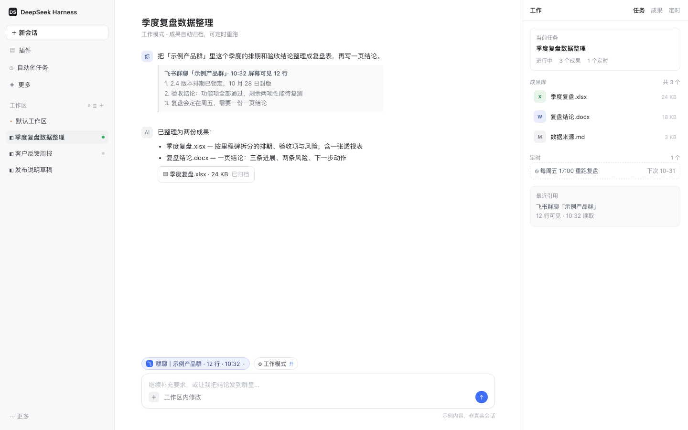
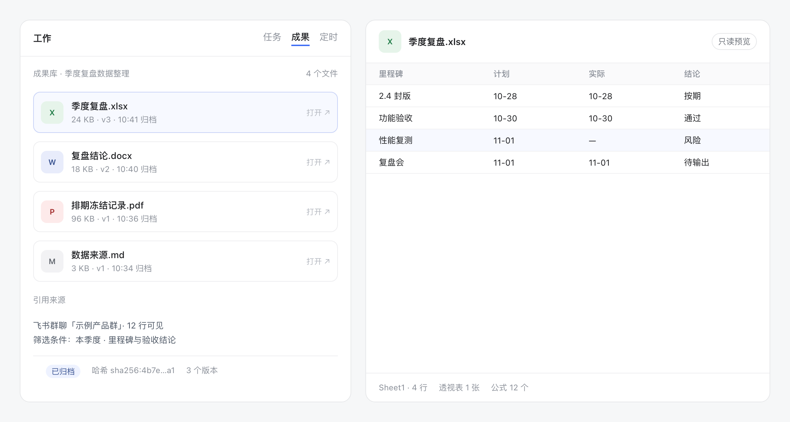
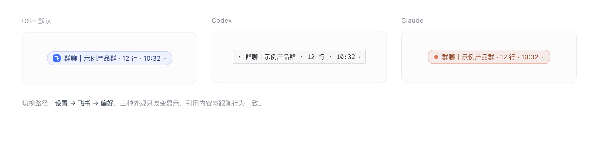

<div align="center">


# DSH Work

**把一句话目标变成 DeepSeek Harness 里可跟踪的工作任务：规划、执行、成果入库、定时重跑，并回写到飞书。**

[English](README.md) · [中文](README.zh.md)

[](https://www.npmjs.com/package/@dsh-work-plug/bundle)
[](https://github.com/silverze/dsh-work-plug/actions/workflows/ci.yml)
[](LICENSE)
[](https://nodejs.org)
[](https://github.com/deepseek-ai)



</div>

DSH Work 给 [DeepSeek Harness](https://github.com/deepseek-ai) 加了一层「工作」能力：一个会话可以挂到一条**工作任务**上，任务比对话活得久，有自己的成果库，能定时重跑；在 macOS 上还能把你正在看的飞书会话一键引用进输入框。

它是插件 bundle，不是 fork：关掉之后，DeepSeek Harness 还是原来的样子。

## 为什么用它

- **工作模式，不是又一个预设。** 只对当前会话生效，默认预设、其他插件和你的设置都不动。
- **成果不随对话消失。** 产出统一收进任务的成果库（docx、pptx、xlsx、图片），几个月后还能从面板打开。
- **重复的活自己跑。** 给任务挂定时（日报、周报），由宿主按时触发。
- **飞书是一等公民。** 14 个面向模型的飞书工具覆盖文档、表格、知识库、消息和云空间；macOS 下还有输入框上方的飞书会话引用 chip。

## 安装

### DeepSeek Harness 桌面端（推荐）

打开 **设置 → 插件**，搜索「DSH Work」，点**安装**，然后重启应用。

### 命令行 / 无界面

```bash
dsh plugin add @dsh-work-plug/bundle
# 之后重启 DeepSeek Harness
```

### 从源码

```bash
git clone https://github.com/silverze/dsh-work-plug.git
cd dsh-work
pnpm install
pnpm build
dsh plugin add ./packages/bundle
```

### 前置条件

| 条件 | 说明 |
| --- | --- |
| DeepSeek Harness `>= 0.2.2-rc.2` | bundle 的 `engines.dsh` 会校验 |
| Node.js `>= 24` | 仅从源码构建时需要 |
| macOS 13+ | 飞书会话 chip 与屏幕文本工具需要 |
| Xcode 命令行工具 | 首次读屏用 `swiftc` 编译，约 25 秒，之后走缓存 |
| 屏幕录制权限 | 首次读屏时 macOS 会弹一次授权 |
| 飞书自建应用凭据 | 仅飞书工具需要，见 [docs/feishu-app-setup.md](docs/feishu-app-setup.md) |

## 快速开始

1. 打开一个会话，点输入框上方的**工作模式**。
2. 直接说你要的结果——「用这三份文档做一版 Q4 复盘 PPT」。
3. 右侧面板变成工作台：当前任务、执行计划和成果库。
4. 在同一会话里继续提要求，每次产出都进成果库。
5. 可选：给任务挂定时，或者一句话把成果分享到飞书云文档。



## 飞书会话引用（macOS）

开启工作模式后，输入框上方会出现一个 chip，显示你最近看的飞书会话：



- **点主体**：插入引用块，包含会话名、读取时间和屏幕上的可见消息。
- **点 ▾**：从最近会话里挑一个，或强制重新读取。
- chip 会在飞书处于前台时**跟随**当前聚焦会话（单次读屏约 1.2 秒，最快每 2.5 秒一次）。
- 读不到时（飞书最小化、在别的桌面、权限被撤销）保留上次会话并标**上次**，依然可以引用。
- OCR 只在本机执行，识别文本只进入当前会话，本插件不上传任何内容。三套外观在**设置 → 飞书 → 偏好**里切换。

## 包含什么

### 工具

| 分组 | 工具 |
| --- | --- |
| 工作任务 | `work_task_create`、`work_task_list`、`work_task_get`、`work_task_prompt`、`work_task_cancel`、`work_task_schedule` |
| 成果库 | `work_artifact_list`、`work_artifact_get`、`work_artifact_scan` |
| 屏幕感知 | `work_frontmost_app`、`work_screen_text`、`work_feishu_screen`、`work_feishu_focus` |
| 诊断 | `work_ping` |
| 飞书 | `feishu_auth_start`、`feishu_auth_status`、`feishu_auth_disconnect`、`feishu_whoami`、`feishu_doc_create`、`feishu_doc_read`、`feishu_doc_append`、`feishu_wiki_get`、`feishu_sheet_read`、`feishu_sheet_write`、`feishu_sheet_append`、`feishu_im_send`、`feishu_drive_upload`、`feishu_share_artifact` |

### 技能

`work-research` · `work-weekly-report` · `work-meeting-minutes` · `work-data-analysis` · `work-deck` · `work-doc-polish` · `work-screen-awareness`

### 界面

- 输入框的工作模式 chip、会话列表里的任务状态、任务菜单（导出 / 移除）。
- 右侧工作台页签：当前任务、成果库、定时。
- 设置里的**飞书**分区：凭据、连接状态、chip 外观。

## 配置

| 键 | 默认值 | 作用 |
| --- | --- | --- |
| `accessTokenEnv` | `DSH_FEISHU_USER_ACCESS_TOKEN` | 从哪个环境变量读取飞书用户令牌 |
| `presence` | `true` | 宿主侧的屏幕/飞书感知工具与 chip 采集总开关 |
| `presenceStyle` | `dsh` | chip 外观：`dsh`、`codex`、`claude` |

任务数据保存在 DSH 的 `work` 存储域里，关掉 bundle 不会丢任务、成果和定时。

## 工作原理

```text
packages/bundle        补丁 + 预设 + 文案：把插件组装进 profile
packages/host-work     任务、成果、定时、感知工具、屏幕 helper
packages/host-feishu   OAuth、OpenAPI 客户端、飞书工具
packages/client-work   工作台面板、输入框 chip、设置（Web 客户端插件）
packages/skills-work   七个内置技能
```

宿主用一个小 Swift helper 读取前台飞书窗口（`CGWindowList` + `screencapture -l` + Vision OCR）；Web 客户端只渲染宿主返回的快照。细节见 [docs/architecture.md](docs/architecture.md)。

## 隐私

- 无遥测、无统计，除你配置的飞书 OpenAPI 外不发起网络请求。
- OCR 文本留在本机，只进入当前会话。
- 飞书令牌存在 DSH 凭据库，绝不进本仓库。
- 完整数据流见 [SECURITY.md](SECURITY.md)。

## 兼容性

| 平台 | 任务 / 成果 / 定时 | 飞书工具 | 飞书 chip / 屏幕文本 |
| --- | --- | --- | --- |
| macOS 13+ | 支持 | 支持 | 支持（需屏幕录制 + Xcode CLT） |
| Linux | 支持 | 支持 | 不支持，工具会返回可行动提示 |
| Windows | 支持 | 支持 | 不支持 |

常见问题：

| 现象 | 处理 |
| --- | --- |
| chip 显示 `飞书未检测到` | 把飞书切到同一桌面/Space 的前台，窗口必须在屏幕上 |
| chip 提示缺少权限 | 系统设置 → 隐私与安全性 → 屏幕录制 → 勾选 DeepSeek Harness |
| 首次读屏约 25 秒 | `swiftc` 正在编译 helper，之后约 1.2 秒 |
| 安装报 `ERESOLVE` | 使用 DSH `>= 0.2.2-rc.2 < 0.3.0`，peer 范围已包含预发布线 |
| 飞书工具提示未连接 | 先执行 `feishu_auth_start` 走完浏览器授权 |

## 开发

```bash
pnpm install
pnpm build
pnpm test            # 先构建 host/client/feishu，再跑 node --test tests/unit/*.test.mjs
pnpm -r typecheck
pnpm check:public    # 内部标识与密钥门禁
pnpm docs:check      # 相对链接与图片检查
```

包结构、如何加工具/技能、测试夹具规则见 [CONTRIBUTING.md](CONTRIBUTING.md)。

## 参与

欢迎提 Issue 和 PR，请先读 [CONTRIBUTING.md](CONTRIBUTING.md) 与 [CODE_OF_CONDUCT.md](CODE_OF_CONDUCT.md)。

## 许可

[MIT](LICENSE) © 2026 silverze

DSH Work 是独立社区项目，与 DeepSeek、飞书/Lark 没有隶属、背书或赞助关系。
