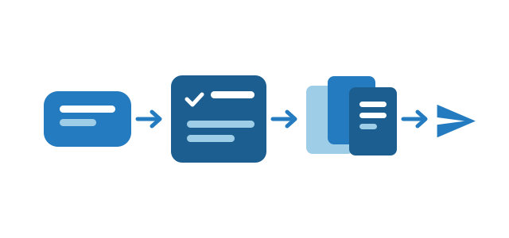

# DSH Work

Turn a stated goal into a tracked work task. DSH Work adds a work mode to a
DeepSeek Harness session: the task keeps its plan, its deliverables and its
schedule after the conversation ends, and can hand results to Feishu.

## What it adds

- **Work mode per session.** A chip above the composer attaches the session to a
  work task; turning it off leaves the default preset and other plugins untouched.
- **Workbench panel.** The right sidebar shows the current task, its artifact
  library and its schedules.
- **Artifact library.** Every deliverable is indexed with size, hash and version,
  and opens from the panel later.
- **Schedules.** A task can rerun on an RRULE; the host triggers it while DSH runs.
- **Feishu tools.** 14 model-facing tools for docs, sheets, wiki, IM, drive and
  artifact sharing, using a Feishu user token.
- **Feishu conversation context (macOS).** A composer chip quotes the Feishu chat
  currently on screen, follows the focused chat while Feishu is in front, and
  offers three appearances (DSH default, Codex, Claude).
- **Seven skills.** Research, weekly report, meeting minutes, data analysis, deck,
  document polish and screen awareness.

## Requirements

- DeepSeek Harness `>= 0.2.2-rc.2 < 0.3.0`
- macOS 13+ for screen reading (Screen Recording permission, Xcode Command Line
  Tools for the first compile); Linux and Windows support everything else
- A Feishu self-built app for the Feishu tools

## Privacy

OCR runs locally and its text goes only to the current session; nothing is
uploaded by the plugin. Feishu credentials live in the DSH credential store. See
the repository's `SECURITY.md`.

## Install

```bash
dsh plugin add @dsh-work-plug/bundle
```

or **Settings → Plugins → search “DSH Work”** in the desktop app, then restart.
