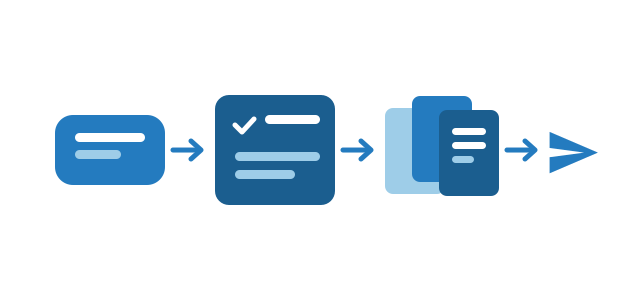

# DSH Work

Turn a stated goal into a tracked work task. DSH Work adds a work mode to a
DeepSeek Harness session: the task keeps its plan, its deliverables and its
schedule after the conversation ends, and can hand results to Feishu.

## What it adds

- **Work mode is a native preset.** Pick it in the mode picker when starting a
  session and the session attaches to a work task automatically; other sessions
  and the default preset stay untouched.
- **Workbench panel.** The right sidebar shows the current task, its artifact
  library and its schedules.
- **Artifact library.** Every deliverable is indexed with size, hash and version,
  and opens from the panel later.
- **Schedules.** A task can rerun on an RRULE; the host triggers it while DSH runs.
- **Feishu tools.** 15 model-facing tools for docs, sheets, wiki, IM, drive and
  artifact sharing, using a Feishu user token.
- **Feishu conversation context (macOS and Windows 10+).** A composer chip quotes
  the Feishu chat currently on screen, follows the focused chat while Feishu is in
  front, and offers three appearances (DSH default, Codex, Claude).
- **Seven skills.** Research, weekly report, meeting minutes, data analysis, deck,
  document polish and screen awareness.

## Requirements

- DeepSeek Harness `>= 0.2.2-rc.2 < 0.3.0`
- macOS 13+ (Screen Recording permission, Xcode Command Line Tools for the first
  compile) or Windows 10+ (no permission prompt, OCR fallback) for screen reading;
  Linux supports everything else
- A Feishu self-built app for the Feishu tools

## Privacy

OCR runs locally and its text goes only to the current session; nothing is
uploaded by the plugin. Feishu credentials live in the DSH credential store. See
the repository's `SECURITY.md`.

## Install

```bash
dsh plugin add @dsh-work-plugin/bundle
```

or **Settings → Plugins → search “DSH Work”** in the desktop app, then restart.
