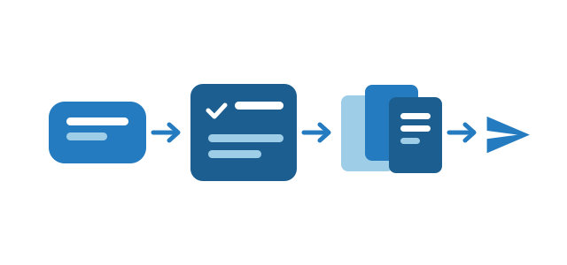

# DSH Work

把一句话目标变成可跟踪的工作任务。DSH Work 给 DeepSeek Harness 的会话加上工作模式：任务在对话结束后仍然保留计划、成果与定时，并能把结果交回飞书。

## 它带来什么

- **按会话开启工作模式。** 输入框上方的 chip 把会话挂到一条工作任务上；关闭后默认预设与其他插件都不受影响。
- **右侧工作台。** 展示当前任务、成果库与定时。
- **成果库。** 每份产出都有大小、哈希与版本，几个月后仍能从面板打开。
- **定时运行。** 任务可以按 RRULE 重跑，DSH 运行时由宿主触发。
- **14 个飞书工具。** 覆盖云文档、表格、知识库、消息、云空间与成果分享，使用飞书用户令牌。
- **飞书会话引用（macOS）。** 输入框上方的 chip 可一键引用屏幕上正在看的飞书会话，飞书在前台时自动跟随，提供 DSH 默认 / Codex / Claude 三套外观。
- **七个技能。** 深度调研、周报、会议纪要、数据分析、汇报 PPT、文档打磨、屏幕感知。

## 前置条件

- DeepSeek Harness `>= 0.2.2-rc.2 < 0.3.0`
- macOS 13+ 才支持读屏（需屏幕录制权限；首次编译需 Xcode 命令行工具）；Linux 与 Windows 支持其余能力
- 飞书工具需要自建应用凭据

## 隐私

OCR 只在本机执行，文本只进入当前会话，插件不上传任何内容；飞书凭据存放在 DSH 凭据库。详见仓库的 `SECURITY.md`。

## 安装

```bash
dsh plugin add @dsh-work-plugin/bundle
```

或在桌面端 **设置 → 插件** 搜索「DSH Work」后安装，然后重启。
